# Claude CRT HUD Mod



Minimal, after a click on `▾ MIN`:



Claude Code mods (plugins of function hooks), kept as one plugin marketplace, `claude-mods`. Each mod
lives in `mods/<name>/` and is listed in `.claude-plugin/marketplace.json`.

| Mod | What it does |
| --- | --- |
| [hud](mods/hud) | A CRT-style status panel above or below the prompt: model, project and git, context with a compact button, plan usage, prompt cache, cost and running tools. |

## Install

In Claude Code:

```
/plugin install hud --marketplace BedirYilmaz/claude-crt-hud-mod
```

From a clone:

```sh
claude plugin marketplace add ~/git/claude-mods
claude plugin install hud@claude-mods
```

A marketplace that is a local folder is read from the folder itself, so after editing a mod, run
`/reload-plugins` in the session.

## Adding a mod

1. Put it in `mods/<name>/` (`.claude-plugin/plugin.json`, `hooks/hooks.json`, `hooks/register.tsx`,
   `types/index.d.ts` when it keeps `$.state`, and `tests/*.test.ts`).
2. Add an entry to `.claude-plugin/marketplace.json` with `"source": "./mods/<name>"`.
3. Run `claude plugin validate mods/<name>` and `claude plugin test mods/<name>`.
